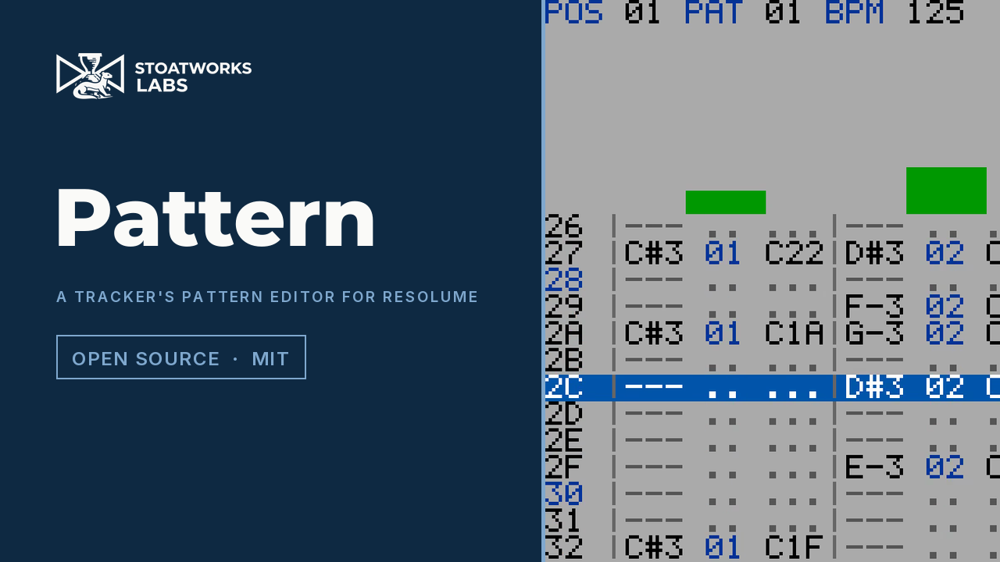
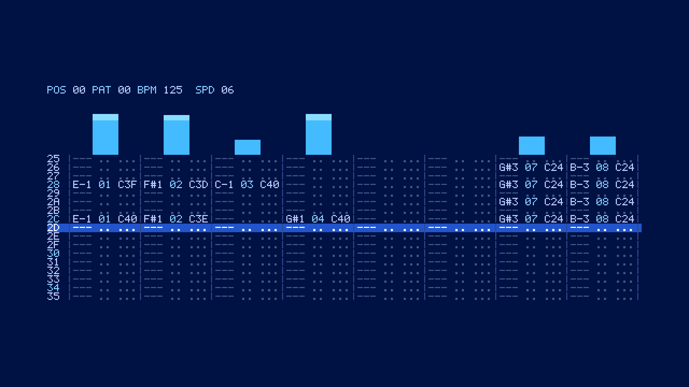
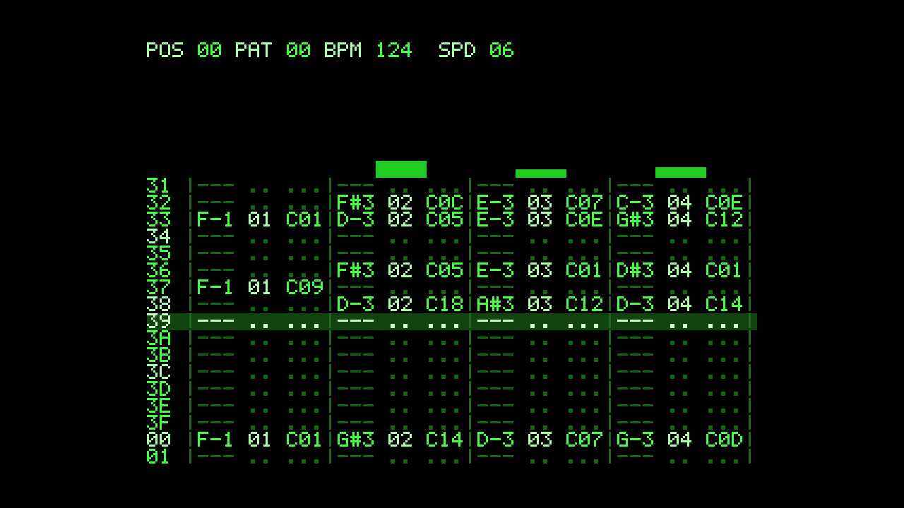

# pattern

> **AI-assisted project.** This codebase was created with [Claude](https://claude.com/claude-code)
> (Anthropic), directed and reviewed by a human author. Everything below is measured by an
> offline harness that drives the real plugin class, and the checks that matter most don't
> need a GPU at all: the row cursor sits on `floor( t / T ) mod 64` on all 36,000 frames of a
> ten-minute run from a host clock at 499 million milliseconds (`pntest --timing`), a burst in
> one band writes one note in the right channel on the right row (`--onset`), loud audio
> that's already playing when the clip starts writes no false notes (`--prime`), and a
> metronome and drum grooves from 80 to 170 BPM are read within ±1 BPM at the right metrical
> level in 4.0 s (`--detected`, `--groove`). All 20 controls that draw change the picture, and
> the bundle registers and draws under the fleet's oxbow host. **It has never been loaded into
> Resolume on macOS**, and no real audio has reached it in a host. The full rundown, including
> what filming the release video turned up, is in the Status section below.

A tracker's pattern editor for Resolume Arena and Avenue, where nobody types the notes in: the
music writes them as it plays. It's an FFGL **source** plugin, and it gives you the look of
someone composing furiously in hex without anyone having to.

Four channels, 125 BPM, the harness's own drum loop. Rendered by the
plugin's offline harness (`pntest`) rather than captured from Resolume.

*[Watch it](https://www.youtube.com/watch?v=xsJ5pMAs9Ss) (55 seconds, with sound): one
channel filling on a kick and bass, every channel filling as the band comes in, the ring
emptying three columns from the cursor down when the band drops out, eight channels under the
Log bin law on the blue theme, the Manual tempo source at half the track's tempo, and Speed 3
with Keep Notes on the green theme. It's all the plugin's own output. An FFGL plugin doesn't
have a window to film, so the footage comes from this repo's offline harness (`pntest --pipe`,
driven by a cue sheet) rather than a screen recording, and the soundtrack is a track
synthesised for the video and fed to the plugin through its real audio input, so what you hear
is what wrote the pattern.*

<!-- downloads:start -->

## Download

**[v0.2.1](https://github.com/stoatworks-labs/pattern/releases/tag/v0.2.1)** — prebuilt for macOS and Windows. Pick your platform:

<b>macOS</b> — Universal (Apple Silicon + Intel)

| Build | Download | Size |
| --- | --- | --- |
| Universal (Apple Silicon + Intel) · .dmg disk image | [`pattern-0.2.1-macos-universal.dmg`](https://github.com/stoatworks-labs/pattern/releases/download/v0.2.1/pattern-0.2.1-macos-universal.dmg) | 270 KB |
| Universal (Apple Silicon + Intel) · .zip archive | [`pattern-macos-universal.zip`](https://github.com/stoatworks-labs/pattern/releases/latest/download/pattern-macos-universal.zip) | 224 KB |

<b>Windows</b> — x64

| Build | Download | Size |
| --- | --- | --- |
| x64 · .exe installer | [`pattern-0.2.1-windows-x86_64-setup.exe`](https://github.com/stoatworks-labs/pattern/releases/download/v0.2.1/pattern-0.2.1-windows-x86_64-setup.exe) | 241 KB |
| x64 · .zip archive | [`pattern-windows-x86_64.zip`](https://github.com/stoatworks-labs/pattern/releases/latest/download/pattern-windows-x86_64.zip) | 132 KB |

All builds, checksums and release notes: [github.com/stoatworks-labs/pattern/releases](https://github.com/stoatworks-labs/pattern/releases).

macOS builds are signed and notarised and open normally. The Windows builds are unsigned, so SmartScreen warns once.

<!-- downloads:end -->

## The one idea

A tracker plays a pattern of 64 rows. The rows move on at a rate set by two
numbers, **Speed** (ticks per row) and **BPM** (a tick lasts 2.5 / BPM seconds),
so at the default speed of 6 there are four rows to a beat. Each row holds one
note per channel: note, sample number, effect.

FFGL doesn't give a plugin any audio output, only the spectrum of whatever's
playing. So Pattern runs the tracker **backwards**: the row cursor runs on a proper
tracker clock, and the music writes into the pattern. Each channel owns a band of
the host's 64-bin spectrum. When an onset lands in that band, a note goes into the
channel on the current row, with its pitch taken from the band's spectral peak, its
volume as a `Cxx` effect from the onset's strength, and its sample number from the
channel.

### What falls out

- **The cursor steps on the beat**, four rows a beat at speed 6, because it runs
  on the tracker's own clock locked to the host's BPM. Nothing's animated.
- **The pattern fills as the track plays.** A busy passage fills every row, and a
  sparse one leaves dots.
- **The ring.** After row `3F` the cursor wraps and the next pass overwrites the
  last. Fills repeat bar by bar, and a change in the arrangement shows up as the
  old notes getting replaced: rows above the cursor are this pass, rows below it
  are the last one.
- **VU bars per channel**, set by each note's volume and falling one step every
  20 ms, the way a meter driven off the vblank falls.

It doesn't play MODs, and it doesn't draw any logos or names. The themes are
colour schemes, named after their colours.

## Controls

- **Clock**: Tempo Source (Host / Detected / Manual), BPM (60–200, for
  Manual), Speed (1–31 ticks a row), Swing (delays odd rows by up to half a
  row), Rows (64 or 32), Keep Notes (a new pass doesn't clear a row).
- **Listening**: Channels (4 or 8), Bin Law (Linear / Log: how the 64 bins are
  laid out in frequency), Bin Value (Magnitude / Power), Sensitivity, Band Split
  (how the bins are divided between channels), Fold Octaves (a pitch outside
  C-1..B-3 is moved by octaves into it rather than shown as `---`).
- **Display**: Theme (Grey / Blue / Green), Rows Visible (3–33), Show VU, Show
  Effects, Scale (whole pixels per screen pixel; 0 is the largest that fits).
- **Tempo Out** *(since v0.2.0; the last group, after About)*: Send
  Tempo (push the detected tempo into Resolume's composition tempo over OSC),
  OSC Port (Resolume's OSC input, 7000), Default BPM (60–200), When Lost (Hold /
  Default), Hide Screen (a transparent output, so it can sit in a show).

## Setting Resolume's tempo (Tempo Out)

FFGL lets a plugin read the host's tempo but never set it. So with **Send Tempo**
on, Pattern sends the tempo it hears to Resolume's own OSC input on 127.0.0.1, as
`/composition/tempocontroller/tempo` in Resolume's absolute form (`,sf "a" 125.0`).
It has to be that form, because Resolume reads a plain float there as 0..1 over
20..500 BPM, so a plain `120` sets 500, which is brisk (measured in Arena 7.27.1).
**Resolume's OSC Input is off by default** (Preferences → OSC).

What goes out is the *confirmed* tempo (three detector readings in a row that
agree, which takes about six seconds of a steady beat), rounded to 0.1 BPM. It's
sent on a change of 0.5 BPM or more, no more than once a second, and resent up to
three times if Resolume's tempo (read back through `SetBeatInfo`) doesn't follow.
Once a tempo's live, a clear change is confirmed from the last three seconds and
sent 3 to 5 s after it as one message (crossfades take longer, and halving or
doubling the tempo goes the careful six-second way). Only one instance per
Resolume sends, and only one that has a tempo to send. If you set the tempo by
hand in Resolume, it's left alone until the music moves. **When Lost** decides
what happens two seconds into silence or eight without a confirmation: Hold (send
nothing; the status row says `HOLD`) or Default (send Default BPM).

It sends the detector's mistakes too (a breakbeat or an off-beat bass at 80–90 can
set Resolume to half or double), and a music clip on BPM Sync transport would hear
every change it makes, so keep music on Timeline. The user guide has the set-up,
the status row and the caveats. **The plugin itself has never sent a tempo to a
Resolume.**

## What it reads, and what is assumed

Resolume tells an FFGL plugin very little about the audio: a 64-bin spectrum once
per frame, and the tempo through `SetBeatInfo`. Nobody in this fleet has measured
how those 64 bins are laid out in frequency, whether they're magnitudes or powers,
or what sample rate is behind them. A level meter can dodge the question (needle
just sums every bin), but a pattern editor can't, because a *band* is a range of
bins and a *pitch* is a bin's frequency. So the two unknowns are controls, **Bin
Law** and **Bin Value**, and the sample rate is whatever the host's
`SetSampleRate` says, or 44.1 kHz if it never says anything. Under Linear at
44.1 kHz only the first three bins land inside a tracker's C-1..B-3, which is why
**Fold Octaves** is on by default: the note *name* is the pitch class of the
band's peak, and only the octave digit is a lie. Turn it off and the pattern says
`---` wherever the pitch is out of range, which is more truthful and a lot duller
to look at.

The clock is rate-locked to the host's tempo and free-running in phase: row 0 is
wherever the clip started, not the host's downbeat. FFGL 2.1 does hand over a
`barPhase`, but nothing here has measured how Resolume drives it, so it isn't
used yet (see `AGENTS.md`).

## Status

**v0.2.1, released 2026-10-12, and still early days.** v0.2.1 makes Tempo Out
follow a change of music in about 4 s, as one message, and say HOLD when it isn't
sure. v0.2.0 (2026-10-11) added **Tempo Out**, which sends the detected tempo to
Resolume over OSC, and **Hide Screen**. v0.1.1 (2026-09-25) fixed the Detected
tempo source, which in v0.1.0 locked to half the real tempo on programme material
(62 for a 125 BPM groove).

What I've verified by measurement on this Mac (Apple Silicon, macOS 26.4), with
`tools/verify.sh` green:

- **The clock.** The cursor is on `floor( 2 i BPM / ( 5 Speed fps ) ) mod Rows`,
  in exact integer arithmetic, on every frame of six ten-minute runs (36,000,
  30,000 and 18,000 frames at 60, 50 and 30 fps) from a host clock in
  milliseconds at 499,000,000 ms, with a swing of a quarter row, and from
  frame 0. A tempo change carries the phase across with no row jump. Keeping the
  phase in a float instead fails on 2,400 of 36,000 frames.
- **Onsets.** Four and eight channels under both bin laws: every channel's burst
  writes its own cell, and only that one cell in the pattern; a burst held across
  a row boundary writes once. A detector that fires on level rather than change
  writes two.
- **Frame one.** Stationary noise at 0.3 per bin already playing when the clip
  triggers, at 40 s and at 499,000,000 ms: no false note in the first second,
  and a real onset at 1.5 s is still heard. Without priming, four false notes.
- **Pitch.** All 64 bins give the predicted note or `---` under Linear and Log,
  folded and unfolded; unfolded, Linear puts 3 bins in range and Log 19; a
  96 kHz sample rate moves the notes as predicted. One semitone sharp fails on
  64 of 64.
- **The ring.** Rows written on pass 0 only are cleared on pass 1 (3 of 3), kept
  with Keep Notes on, rows written on both carry pass 1's note, and a jump of 520
  rows clears the pattern. A pass that never clears fails.
- **Detected tempo, on a metronome.** 120 BPM at 60 fps, 100 at 50, 150 at 60
  and 120 at 24 fps are all within ±1 BPM by **4.00 s** and hold for twelve; the
  row clock follows it over a host saying 77. A lag scaled by 1.1 reads 109.08
  and never settles.
- **Detected tempo, on grooves** (`--groove`). Drum grooves rendered as audio
  and put through the harness's FFT: a backbeat (kick on 1 and 3, clap on 2
  and 4, hats on the eighths), the same with the clap 12 dB and the hats 20 dB
  down, a syncopated kick, and the video's syncopated pluck over a backbeat, at
  80, 90, 100, 110, 125, 140, 150, 160 and 170 BPM, plus the release video's
  house groove at 115–135 and four frame rates. All 45 read within ±1 BPM at
  the right metrical level by **4.00 s** and hold for sixteen, and the worst error
  after settling is 0.26 BPM. v0.1.0's detector, kept as the negative control,
  fails 15 of the 45 (160 for 80, 200 for 100, 62.1 for the video's 125). The
  release video's own soundtrack reads 124.5–125.0 at 30 fps and 60 fps from
  4 s to the end, where v0.1.0 read 62 and 100 at 30 fps.
- **The picture.** At 640×360 and 320×180, at Scale 1–4 and Auto, four and
  eight channels: every s×s block aligned to the plugin's origin is one colour
  (57,600 blocks at 640×360 Scale 1), every pixel outside the screen is the
  theme background, and the probed cells match the font table bit for bit. A
  fractional scale fails on 576 glyph pixels; a one-row shift in the shader
  (the mutation test) fails 36 assertions.
- **No dead controls.** All 20 that draw change the picture at 640×360 and at
  320×180. Send Tempo and OSC Port aren't swept (switched on, the render would
  send to port 7000), so `--send` and `--osc` measure them instead.
- **Tempo Out** *(v0.2.0)*, against a fake Resolume (`--send`): a metronome
  at 120 is sent once in 60 s, at 6.00 s; 120 then 140 is two sends; a
  Resolume that never takes it gets 1 + 3 sends two seconds apart and then
  `NOT TAKEN`; a hand on Resolume's tempo isn't fought; Hold sends nothing when
  the music stops and Default sends Default BPM 2 s into the silence; two
  instances send once between them and the second takes over 2 s after the
  first's clip stops; the release video's groove at 30 fps is sent once, 124.8
  at 6 s; 72 one-minute runs of steady noise as audio send nothing. With no
  hysteresis the metronome is sent 54 times, and trusting every detector
  publication, the noise sends 82 tempos. On the wire (`--osc`): the plugin's
  own socket delivers the 48 bytes of `,sf "a" 120.0`, byte for byte, to a
  listener on 127.0.0.1 (never 7000), follows an OSC Port change at once, and
  sends nothing when off; the plain-float form fails the byte check.
- **Following a change** *(v0.2.1)*, `--follow`: the release
  video's groove at 124 cut to five other grooves at 30 and 60 fps is sent
  4.0 s after the cut (v0.2.0: 6, up to 8), as one message, and none of 30 changes
  (cuts, 3 s gaps, 8 s crossfades) sends anything but the new tempo (v0.2.0: 5
  in-between values). A steady backbeat at 128, 30 fps, is sent once in 60 s
  (v0.2.0: 14 times). A second instance that hears a beat sends it while the
  first hears nothing (v0.2.0: never). That's on rendered grooves through the
  harness's FFT and a fake Resolume; it hasn't been run in Resolume with audio.
- **Hide Screen** leaves every one of 230,400 pixels transparent black while
  the pattern carries on underneath (`--grid`).
- **The pipe.** Three 64×36 frames are 27,648 bytes; a reader that hangs up
  gets exit status 1, not SIGPIPE's 141.
- **Cost**, `pntest --bench` (fastest of five passes of 200 frames, the drum
  loop playing, glFinish both sides): **0.041 ms at 1280×720, 0.054 ms at
  1920×1080, 0.128 ms at 3840×2160**, which is under one per cent of a 60 fps
  frame. Apple Silicon only; the CPU side is a few hundred multiply-adds a frame.
- The bundle is universal (`lipo`: x86_64 arm64), exports `plugMain`, ad-hoc
  signs, and probes under oxbow as **SW Pattern / PN01 / source / inputs 0..0**.

What isn't verified yet:

- **Never loaded into Resolume on macOS.** Everything above is the offline
  harness driving the real plugin class in a headless GL context. How the 22
  controls in four groups show up in the inspector there is untested.
- **Tempo Out has never sent a tempo to a Resolume.** The message form was
  measured in Arena 7.27.1 on Windows by sending it from outside the plugin.
  The plugin's own send, Resolume reporting the new tempo back through
  `SetBeatInfo`, a clip at zero opacity still running, and Hide Screen under
  Resolume's blend modes are all unmeasured.
- **No real audio has reached it in a host.** The 64 bins' layout, value law and
  sample rate are assumed (`Bin Law`, `Bin Value`, `SetSampleRate`), and the
  onset detector's thresholds were set on synthetic spectra and synthesised
  tracks, not on programme material through Resolume's FFT.
- **The harness has run on this Mac's GPU and on CI's software renderer**
  (`ci.yml`, green on the release commit); nothing has timed it anywhere else.
- **On Windows it has been loaded into Resolume**: a build of this source
  loads, registers as `SW Pattern` / `PN01` / source and renders in Resolume
  Arena 7.27.1 on software rendering (win-lab, Mesa llvmpipe, no GPU), with
  all 23 host controls matching the declaration and the five visual controls
  moving the picture, which is 9 of the fleet gate's 9 checks. The box has no
  sound device, so its 12 audio-driven controls weren't exercised there, and the
  Manual BPM couldn't be shown moving on the gate's still.
- No factory presets and no OpenFX port. There's a [user
  guide](https://stoatworks-labs.com/software/pattern/guide/) and a [browser
  demo](https://pattern-demo.stoatworks-labs.com), which is a port rather than
  the plugin.

What filming the release video turned up, on a synthesised 125 BPM track through
`pntest --wav` (the harness's own FFT, not Resolume's):

- **A quiet band hears the leading edge of any sharp transient.** The detector
  reads the first frame that contains an onset, and the first milliseconds of
  a click are broadband, so a kick with a 1 ms attack wrote every channel until
  each band's floor had learned the leak (about a second). The 1e-4 absolute
  floor is far below that kind of leakage. That's why the video's instruments
  have soft attacks and steep filters, and the guide says so.
- **A band holding a sustained instrument adapts to it.** With the bass under
  the kick in bin 0, the kick failed the ratio in its own band and the next
  band up wrote it from the leak, naming that band's peak bin.
- **The tempo detector read the bar, not the beat**, on the track: 62 for 125
  in three takes (100 on a syncopated cut). **Fixed in v0.1.1.** The raw summed
  flux let the kick outweigh the clap, so the envelope repeated at the half
  note. The detector now standardises three registers (low, mid, high) before
  summing, scores each period with its grouping and subdivision, and takes the
  fastest level that scores within 0.70 of the best; `AGENTS.md` has the
  details. The video (made with v0.1.0) still shows the Manual source instead.
- **What v0.1.1 still reads at the wrong level:** a breakbeat with ghost snares
  and sixteenth hats (double at 80, half from 140 to 170, unsettled at 125;
  right at 90–110), and a four-on-the-floor with an off-beat bass at 80 and 90
  (read as 160 and 180: its eighths are a real pulse at twice the tempo; right
  from 100 to 170). `--groove` measures and prints both, but doesn't assert them.
  Use Host or Manual for that sort of material.

## Browser demo

**<https://pattern-demo.stoatworks-labs.com>** runs the plugin's own shader, copied
unedited into WebGL2, over a JavaScript port of its tracker (the row clock, the
ring, the onset and tempo detectors, the meters), its screen composer, layout,
palettes, parameter conversions and font. **There's no audio in the page.** A
pattern editor with no audio is an empty grid, so the page makes up a 64-bin
spectrum itself (a drum-loop-ish programme of kick, clap, a stab and hats on its
own clock, nothing sampled) and hands the port the programme's tempo the way a
host would through `SetBeatInfo`. That's the page's spectrum, not Resolume's FFT,
whose layout, value law and sample rate are unknown, and the onset thresholds
were set on synthetic spectra like it. Speed, Rows Visible and Scale are
dropdowns there because the demo kit has no integer control. The port's only
check is someone reading it; the shader copy is checked by
`demo/tools/check_shaders.py`, run by `tools/verify.sh`. See `demo/README.md`.

## Installing

Copy `Pattern.bundle` (macOS) or `Pattern.dll` (Windows) into

    ~/Documents/Resolume Arena/Extra Effects        (or "Resolume Avenue")
    Documents\Resolume Arena\Extra Effects           (Windows)

then restart Resolume. It shows up under **Sources**.

## Building

    git clone --recursive https://github.com/stoatworks-labs/pattern
    cmake -B build -DCMAKE_BUILD_TYPE=Release
    cmake --build build
    cmake --install build          # into Arena's Extra Effects, macOS

The macOS build is universal (arm64 + x86_64) by default; add
`-DCMAKE_OSX_ARCHITECTURES=arm64` for a quicker development build. Windows needs
GLEW from vcpkg, and `.github/workflows/release.yml` has the full configure
line.

## Building and testing

The offline harness drives the real plugin class. Eleven of its twelve check groups
don't open a GL context at all, because what they check is the tracker's published
state, and a rasteriser has no opinions about that:

    ./build/pntest --timing        # the cursor, from a host clock at 499 million ms
    ./build/pntest --onset         # one note, right channel, right row, nowhere else
    ./build/pntest --prime         # frame one, with loud audio already playing
    ./build/pntest --pitch         # the bin law's note, both laws, folded and not
    ./build/pntest --ring          # the next pass overwrites, clears or keeps
    ./build/pntest --detected      # a metronome within +-1 BPM in 4 s
    ./build/pntest --groove        # drum grooves as audio, 80..170 BPM, the right metrical level
    ./build/pntest --send          # Tempo Out: what is sent to Resolume and when (a fake Resolume)
    ./build/pntest --osc           # Tempo Out: the exact bytes, through a socket on 127.0.0.1
    ./build/pntest --grid          # and the one check that reads a rasteriser
    ./build/pntest --bench         # 720p through 4K
    ./build/pntest --out /tmp/f.png --size 1920x1080 --frames 300 --audio beats --host-bpm 125
    python3 tools/sweep.py         # no control is silently dead
    tools/verify.sh                # all of it, in about a minute

For video, `--pipe` writes raw RGBA frames to stdout, driven by a cue script and
by audio that reaches the plugin through its real audio input: a synthetic
preset (`--audio beats|metronome|tone:N|noise|sweep`), a WAV file through a
2048-point FFT folded into 64 bins (`--wav track.wav`), or macroblock's
one-line-per-frame spectrum file (`--spectrum bins.txt`):

    ./build/pntest --pipe --size 1920x1080 --fps 60 --wav track.wav --host-bpm 124 \
      --script cues.txt | ffmpeg -f rawvideo -pix_fmt rgba -s 1920x1080 -r 60 -i - out.mov

A cue script is `frame  Parameter Name  value` lines; `Host BPM` and `Bin 0`..
`Bin 63` are accepted there too.

## Diagnostics

pattern writes a plain-text log every time it runs:

    ~/Library/Logs/pattern/pattern.YYYY-MM-DD.log                        (macOS)
    %LOCALAPPDATA%\pattern\logs\pattern.YYYY-MM-DD.log                   (Windows)
    ${XDG_STATE_HOME:-~/.local/state}/pattern/logs/pattern.YYYY-MM-DD.log

It records the build, the GL driver, what unit the host's clock turned out to
be in, whether any audio reached the layer, and which tempo the clock is following
(the first two of which are the commonest reasons a pattern never fills), and,
once Send Tempo has been on, each change in what Tempo Out is doing (those lines
start `tempo out:`).

<!-- attributions:start -->
This project is built on other people's work — see [ATTRIBUTIONS.md](ATTRIBUTIONS.md).
<!-- attributions:end -->

## Licence

MIT. See [LICENSE](LICENSE).

The tracker conventions this follows (64 rows, a tick of 2.5 / BPM seconds,
Speed ticks a row, hex row numbers, `C-1` to `B-3`, a `Cxx` volume effect) are
the genre's public arithmetic rather than anybody's source. No code, font, screen
layout or asset was taken from any tracker, and none is named on screen.
