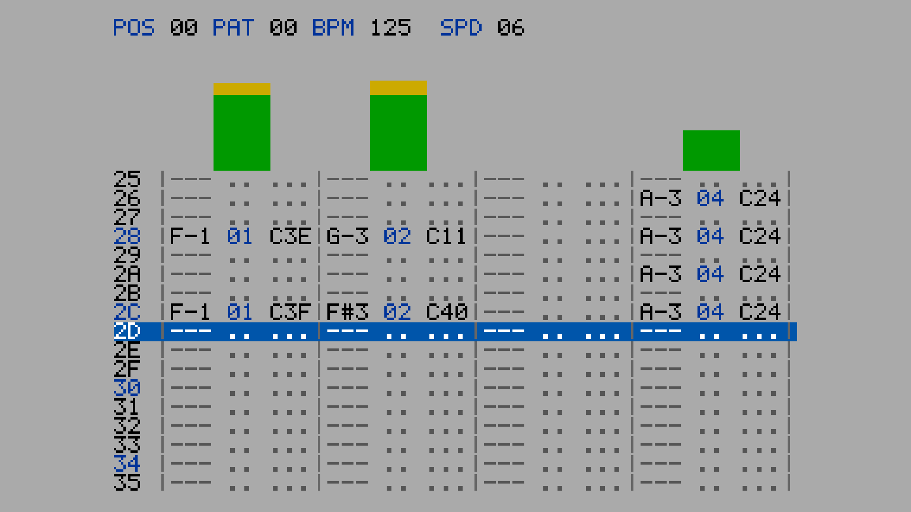

# Pattern user guide

Pattern is an FFGL source for [Resolume](https://resolume.com) Arena and Avenue that draws a
tracker's pattern editor and lets the music write it as it plays: the row cursor runs on the
tracker's own clock at Resolume's tempo, and every onset it hears in a channel's band of the
spectrum writes a note into that channel on the current row.

It doesn't play any music, and it doesn't animate a screen either. It runs a tracker
backwards. The cursor steps four rows a beat at the default Speed, rate-locked to Resolume's
tempo, a busy passage fills the pattern, a sparse one leaves dots, and after row `3F` the
cursor wraps and the next pass overwrites the last. You get the look of someone composing
furiously in hex, without anyone having to.



*Four channels at 125 BPM, the harness's own drum loop, rendered by the offline harness rather
than captured from Resolume. Each channel column reads note, sample number and effect; the
blue row is the cursor.*

> **Before you rely on this:** it's at **v0.2.1**, and still early days. The tracker is
> measured rather than taken on trust, by a harness that drives the real plugin class, and
> twelve of its thirteen check groups don't open a GL context at all. They show that:
>
> - the row cursor sits on floor(t / T) mod 64 on every one of 36,000 frames of a ten-minute
>   run at 60 fps (and 30,000 at 50, 18,000 at 30) from a host clock at 499,000,000 ms, with
>   swing and across a tempo change;
> - a burst in band k writes one note, in channel k, on the row that's current at that frame,
>   at four and eight channels under both bin laws;
> - loud audio already playing when the clip starts writes no false note in its first second;
> - all 64 bins give the predicted note or `---` under Linear and Log, folded and unfolded;
> - the next pass clears, keeps and overwrites precisely the rows it should;
> - a metronome is detected within 1 BPM by 4.00 s at four frame rates, and so are 45 drum
>   grooves rendered as audio from 80 to 170 BPM, at the right metrical level;
> - at 640 × 360 and 320 × 180, at Scale 1 to 4 and Auto, every scaled block is one colour
>   and every probed glyph matches the font table bit for bit.
>
> Eight faults put in on purpose are shown to make those checks fail (one of them is v0.1.0's
> own tempo detector), and a one-character change to the shipped shader fails 36 assertions.
> All 20 controls that draw are shown to change the picture (Send Tempo and OSC Port, which
> only send, are checked against a socket the harness owns).
>
> It has **never been loaded into Resolume on macOS**, and **no real audio has reached it in a
> host of mine**: the one host I've run it in there is the fleet's own test host, `oxbow`. On Windows, a
> build of the v0.2.1 code loads, registers as a source and renders in Resolume Arena 7.27.1,
> with all 28 host controls matching what the plugin declares (2026-10-12; v0.1.0 passed the
> same with 23). That was on software rendering (win-lab, Mesa llvmpipe, no GPU), so it says
> nothing about a GPU. That box has no sound device, so its 12 audio-driven controls weren't
> exercised there. Of the other nine, eight moved the picture, the Manual BPM among them (it
> changes three digits in the header, which v0.1.0's run couldn't show), and When Lost was
> inconclusive on the gate's still picture. Try it on a spare layer before you put it in a show.
>
> **Tempo Out is new in v0.2.0 and unverified in a host.** What it sends was measured
> against Resolume Arena 7.27.1 by sending the same message from outside the plugin. On my
> own machines the plugin itself has never sent anything to a Resolume (one user had v0.2.0
> setting the tempo on his rig, and found it slow to follow a change:
> [#5](https://github.com/stoatworks-labs/pattern/issues/5)), and nothing has checked that
> Resolume reports its new tempo back to the plugin. See [Tempo Out](#tempo-out-setting-resolumes-tempo).
>
> This codebase was created with AI assistance, directed and reviewed by a human author.

---

## Installing

Every download has one source in it, **SW Pattern**. Drop it into Resolume's effects folder and
restart Resolume:

```
macOS    ~/Documents/Resolume Arena/Extra Effects/
Windows  %USERPROFILE%\Documents\Resolume Arena\Extra Effects\
```

Avenue uses the same layout under its own folder name. The plugin then shows up under
**Sources** as **SW Pattern**.

The macOS download is a universal build (Apple silicon and Intel), as a `.dmg` or a `.zip`.
It's Developer ID-signed and notarised, so the bundle just loads. The Windows download
is an x64 installer or a `.zip`. It isn't code-signed, so the installer trips SmartScreen
once: **More info** → **Run anyway**.

---

## The tracker runs backwards

A tracker plays a pattern of 64 rows. The rows move on at a rate set by two numbers: **Speed**,
in ticks a row, and **BPM**, where a tick lasts 2.5 / BPM seconds. At the default Speed of 6
a row is 15 / BPM seconds, so there are four rows to a beat and a 64-row pattern is four bars.
Each row holds one note per channel: a note name, a sample number and an effect.

FFGL doesn't give a plugin any audio output, only the spectrum of whatever's playing, once a
frame, as 64 bins. So Pattern can't play a pattern. It writes one instead. The row cursor runs
on a proper tracker clock, rate-locked to the host's BPM. Each channel owns a band of the 64 bins. When the
energy in a band rises sharply, an **onset**, the plugin writes a note into that channel on the
row the cursor is on: the note's **pitch** is the band's loudest bin, read through the bin law
and folded into the tracker's three octaves, its **volume** is a `Cxx` effect from how far the
onset stood over the band's recent level, and its **sample number** is the channel's. The strongest
onset in a row wins the cell. Above each channel a VU bar is set by the note's volume and falls
one step every 20 ms, the way a meter driven by the vertical blank falls.

That's the whole plugin, and the look follows from it:

| the rule | what comes out |
| --- | --- |
| the cursor runs on a clock, not an animation | it steps on the beat, four rows a beat at Speed 6, and a tempo change carries the phase across without a jump |
| nothing is written that was not heard | a busy passage fills every row; a sparse one leaves dots; silence leaves the pattern as it was |
| the ring: a row is cleared as the cursor enters it | after `3F` the next pass overwrites the last; rows above the cursor are this pass, rows below it are the last; when the band drops out, its columns empty from the cursor down |
| one band per channel | each column is one part of the spectrum: at the defaults, below 1.1 kHz, 1.1 to 5.2 kHz, 5.2 to 12.7 kHz and above, at 44.1 kHz |
| the peak bin names the note | the note column is the pitch class of the loudest bin in the band, so a bass line reads as different notes and a snare reads as one |

It doesn't play MODs. It doesn't draw any logos or any tracker's name; the themes are named by
colour, and the font is my own.

---

## Start here

Put SW Pattern on a layer and play something with a beat. Out of the box you get four
channels on the grey theme, the cursor on Resolume's tempo at Speed 6, 17 rows visible, VU bars
and the effects column, scaled to the largest whole number of pixels that fits the layer.

Then:

1. **Watch the cursor.** It moves four rows a beat because it runs on the tracker clock.
   Change Resolume's BPM and it follows; **Speed → 3** and it runs eight rows a beat, a pass
   in under four seconds at 125 BPM; **Speed → 12** and it crawls.
2. **Watch the ring.** After row `3F` the cursor wraps and starts overwriting. Mute a channel
   of your music and its column empties from the cursor down while the rows below still show
   the last pass. **Keep Notes on** and nothing is cleared: the pattern fills to solid over a
   few passes.
3. **Channels → 8.** The spectrum is split eight ways; the screen gets wider. **Show Effects
   off** narrows each channel to note and sample so eight fit at a larger Scale.
4. **Bin Law → Log** and the same bins mean different notes: the low bins spread over more
   of the pattern's range. Turn **Fold Octaves** off and every pitch outside C-1 to B-3 shows
   as `---`, which is accurate but a lot duller to look at.
5. **Sensitivity** down if every row is written, up if the pattern stays empty. **Band Split**
   moves the boundaries between channels towards or away from the low end.
6. **Tempo Source → Manual** and the cursor runs on the BPM slider, whatever Resolume or the
   music is doing.
7. **Send Tempo on** (after switching on Resolume's OSC input, see Tempo Out) and Resolume's
   own tempo follows the music. **Hide Screen on** and the layer shows nothing while it does.

Every slider is declared to the host as 0 to 1, except Speed, Rows Visible, Scale, OSC Port and
Default BPM, which are integers.
The value each position stands for is given with each control below.

---

## The Clock group

**Tempo Source** — **Host**, **Detected** or **Manual**; Host by default. Where the row clock
gets its BPM. Host is Resolume's tempo, delivered through the FFGL beat info; Detected is the
plugin's own estimate from the audio (see below); Manual is the **BPM** slider. The clock is
rate-locked only: row 0 is wherever the clip started, not the host's downbeat.

**BPM** — 60 to 200 (0 to 1 is 60 + 140 × the slider; 125 by default). Used only when Tempo
Source is Manual. Resolume should show the slider in BPM ("125.0 BPM") rather than as 0 to 1;
that hasn't been seen in a Resolume yet.

**Speed** — **1 to 31**, an integer, **6 by default**. Ticks a row; a tick is 2.5 / BPM
seconds, so a row is Speed × 2.5 / BPM seconds and at 6 there are four rows a beat. The header
shows it as `SPD`.

**Swing** — 0 to 1; **0 by default**. Delays every odd row by up to half a row (the slider is
half a row at 1), so pairs of rows play long-short.

**Rows** — **64** or **32**; 64 by default. The pattern's length, and so the ring's: at 125
BPM and Speed 6 a 64-row pass takes 7.68 s and a 32-row pass half that.

**Keep Notes** — off by default. On, a row is never cleared as the cursor enters it, so every
pass adds to the last and the pattern fills to solid. Off, clearing is what makes a sparse
passage leave dots and an arrangement change show as replacement.

---

## The Listening group

**Channels** — **4** or **8**; 4 by default. How many channels, and so how many bands the 64
bins are split into. Changing it re-lays the screen.

**Bin Law** — **Linear** or **Log**; Linear by default. What a bin *means* in hertz: under
Linear the 64 bins run evenly from 0 to half the sample rate (a bin is 345 Hz wide at 44.1
kHz), under Log they run in equal ratios from 20 Hz to half the sample rate. Nobody has
measured which one Resolume does, so it's a switch. It changes the note each bin names and the
frequencies at which the band boundaries fall, not which bins a channel gets.

**Bin Value** — **Magnitude** or **Power**; Magnitude by default. Whether the host's bins are
read as amplitudes or as powers (square-rooted). The other unmeasured fact about Resolume's
spectrum; Power makes quiet bins count for more.

**Sensitivity** — 0 to 1; **0.5 by default**. The onset threshold, as a ratio over each band's
running level of change: about 12 at 0, 4.2 at the default and 1.5 at 1. Lower it if the
pattern stays empty, raise it if every row is written.

**Band Split** — 0 to 1; **0.4 by default**. Tilts the band boundaries towards the low end:
the edges sit at (k / N)^γ of the way through the bins, γ from 1 at 0 (equal widths, which
under Linear puts the whole of the music into channel 1) to 4 at 1. At the default four
channels own bins 0-2, 3-13, 14-33 and 34-63.

**Fold Octaves** — on by default. A tracker's range is C-1 to B-3, three octaves, and under
Linear at 44.1 kHz only the first three bins fall inside it. On, a pitch outside the range is
moved by whole octaves into it, so the note name is the pitch class the band's peak has and
only the octave digit is a fiction. Off, an out-of-range pitch shows as `---`.

**Audio** — the host's audio input, the FFT buffer Resolume fills. Which layer or composition
it listens to is chosen in Resolume's inspector.

---

## The Display group

**Theme** — **Grey**, **Blue** or **Green**; Grey by default. Three colour schemes, named by
colour: black on grey with blue accents, light blue on navy, green on black.

**Rows Visible** — **3 to 33**, an integer, **17 by default**. How many pattern rows the
screen shows; the cursor sits at the middle one (an even count has one more row below the
cursor than above). Fewer rows make a shorter screen, which Auto scaling can then draw larger.

**Show VU** — on by default. The VU bar above each channel: 48 steps, set by each note's
volume, falling one step every 20 ms.

**Show Effects** — on by default. The `Cxx` volume column in each channel. Off, a channel is
note and sample only, about a third narrower, which is how eight channels fit at Scale 3 on a
1080p layer.

**Scale** — **0 to 8**, an integer, **0 by default**, which is **Auto**: the largest whole
number of screen pixels per plugin pixel at which the whole screen fits the layer both ways,
never less than 1. 1 to 8 are that many pixels per pixel, exactly; a screen that doesn't fit
is centred and cropped. Scaling is always by whole pixels, so every glyph edge is a pixel edge.

---

## The header

`POS` and `PAT` count passes (the pass modulo 128 and 64, in hex); there's no song and no
order list. `BPM` is the tempo the clock is running on, with `*` after it (Tempo Source on
Detected) while the detected tempo is confirmed and live, and `?` otherwise. `SPD` is the Speed.
With Send Tempo on, the row under the header shows Tempo Out's state (see Tempo Out).

---

## The clock, exactly

The row phase is `base + (t − anchor) / T` in double precision, where T is the row period
Speed × 2.5 / BPM, and the row is its floor with an allowance of a millionth of a row. When the
period changes, the phase is carried across at that instant and counted from there under the
new period, so a tempo change never jumps a row. Resolume's host clock runs to hundreds of
millions of milliseconds, and a phase kept in single precision fails on 2,400 of 36,000 frames
at that magnitude, which is why it isn't kept that way.

A host time that goes backwards is treated as a loop point: the phase is carried across and no
time passes, so a looping clip keeps its cursor moving rather than snapping to row 0. A jump
forward of more than a whole pattern clears it.

---

## The listening, exactly

Frame one primes the detector: the previous spectrum is set to the current one and each band's
floor is seeded at an eighth of its level, so a clip that triggers on top of loud audio writes
nothing false in its first second and still hears a real onset a moment later. From then on
each band's **flux** is the sum over its bins of the rise in magnitude since the last frame;
an onset is a flux that is rising, over a 50 ms refractory period, and above the band's floor
(a one-second running mean of its flux) times the Sensitivity ratio. The volume is
64 × log2(flux / threshold) / 3, so an onset just over the line is `C01` and one eight times
over it is `C40`.

Two consequences, both turned up while filming the release video, and both worth knowing:

- **A quiet band hears the leading edge of any sharp transient.** The detector reads the first
  frame that contains an onset, and the first few milliseconds of a click are broadband. A
  band with nothing of its own has a floor near zero, so a kick with a hard attack writes
  every channel until each band's floor has learned the leak, about a second later. Sounds
  with soft attacks stay in their own columns; Sensitivity lowers the floor's share but not
  the absolute floor.
- **A band holding a sustained instrument adapts to it.** A bass under a kick keeps that
  band's floor high, so the kick can fail the ratio there while a quieter neighbouring band
  hears it through leakage and writes it instead. The note column then names the neighbour's
  peak bin.

---

## Detected tempo

With Tempo Source on Detected the plugin works out the beat from the audio itself. It keeps
three onset envelopes at 100 Hz, one each for the low end (below 400 Hz: kick, bass), the
middle (400 Hz to 5 kHz: snare, clap, most pitched parts) and the top (hats, cymbals), and
evens them out so a quiet clap counts as much as a loud kick. Once a second it looks at the
last six seconds for the period that repeats best together with its subdivision and its
grouping, and takes the fastest level that holds up: the beat rather than the half note, and
the beat rather than the eighths. A reading is used only when the one before it agrees within
2 %, so the first appears after about four seconds and a single stray reading never moves the
clock. The row clock follows the estimate, re-anchoring the phase each time it changes. The
three registers are fixed: the Channels and Band Split controls don't change what the tempo
detector hears.

The header's `*` means the tempo is **confirmed and live**: three readings in a row, a second
apart, that agree within 2 % and were each made on clear evidence while something was playing
(about six seconds into a steady beat). The confirmed tempo is the average of the latest readings
that agree, up to eight, so it doesn't wobble with them. Once a tempo is live, a clear change
(more than 2 %, and not to half, double, two thirds or one and a half times it) is confirmed from
the last three seconds alone, when two such readings in a row agree within 1 % on strong evidence:
about three to four seconds after a hard cut. The `*` turns back to `?` when the music has been
silent for two seconds, or when nothing has been confirmed for eight; after a silence that long,
the music that follows is confirmed afresh. This is the tempo Tempo Out trusts (below); the clock
itself still follows the latest reading, as it always has.

Measured, through the offline harness's own FFT (not Resolume's):

- A metronome at 120, 100 and 150 BPM, at 24 to 60 fps, is found within ±1 BPM at **4.00 s**
  and held for twelve seconds, with the row clock running at the detected tempo over a host
  saying 77.
- **45 drum grooves rendered as audio**: kick on one and three with a clap on two and four
  and hats on the eighths; the same with the clap and hats far quieter; a kick on the "and" of
  two as well; a syncopated pluck over the top; each at 80, 90, 100, 110, 125, 140, 150, 160
  and 170 BPM; and the release video's four-on-the-floor house groove at 115 to 135. All of
  them read within ±1 BPM of the right tempo (not its half or double) by 4.00 s and hold it,
  and the worst error after that is 0.26 BPM.
- The release video's own soundtrack reads 124.5 to 125.0 for its whole length at 30 and
  60 fps.

**v0.1.0 read the half note.** Version 0.1.0 summed all the audio into one envelope, where a
loud kick outweighed the clap, and it read **62** for the video's 125 BPM groove, 160 for a
backbeat at 80 and 200 for one at 100. v0.1.1 replaces it, so if you set up a show with
v0.1.0 and switched to Host because of this, Detected is worth another try.

**Noise publishes.** Steady noise, played as audio, gets a tempo out of the detector now and
then (in most of 72 one-minute runs of filtered noise, always on weak evidence). The clock
follows it, but Tempo Out doesn't, because those readings never confirm.

**Still wrong, and the harness prints it rather than hiding it:** a breakbeat with ghost snares
and sixteenth hats reads double at 80 BPM and half from 140 to 170; a four-on-the-floor with
an off-beat bass reads double at 80 and 90, because its eighths really are a pulse at twice
the tempo. Nothing has been measured through Resolume's own FFT. For such material, and for
anything the show depends on, use Host or Manual.

---

## Tempo Out: setting Resolume's tempo

*Added in v0.2.0. v0.2.1 follows a change of tempo in seconds rather than up to ten, sends one
message for it rather than the values in between, and says HOLD on the status row when it has
nothing it trusts.*

With **Send Tempo** on, Pattern pushes the tempo it hears into Resolume's own composition tempo,
so the BPM-synced parts of a show follow the music without anyone typing a BPM. It can sit on a
layer of its own doing nothing else: **Hide Screen** makes its output transparent.

FFGL doesn't give a plugin any way to set anything in its host, so this does it the way any
other controller would: one OSC message to Resolume's OSC input on this machine (127.0.0.1).

### Setting it up

1. **Switch on Resolume's OSC input: Preferences → OSC → OSC Input.** It's **off by default**,
   and while it's off nothing Pattern sends gets there. Its port is 7000 unless you've changed it.
2. Put **SW Pattern** on a layer of its own and set its **Audio** input (in the Listening group)
   to what the tempo should be taken from: **Composition** for whatever is playing in Resolume,
   **External** for the audio input.
3. Set **OSC Port** to Resolume's OSC input port if it isn't 7000.
4. Turn **Send Tempo** on. Turn **Hide Screen** on if the layer should show nothing.
5. Keep the clip playing. A clip that isn't playing isn't running, and nothing is sent.

The Tempo Out group is the last in the inspector, after About.

With Hide Screen off, the row under the header says what Tempo Out is doing, whatever Tempo
Source is set to:

| row | meaning |
| --- | --- |
| `OSC 7000 HOLD` | When Lost is Hold and nothing confirmed fits what is playing now: nothing confirmed yet, the tempo lost, or the detector no longer agreeing with the last one. Nothing new is sent; Resolume keeps its tempo |
| `OSC 7000 125.0 SENT` | sent; Resolume's tempo has not come back yet |
| `OSC 7000 125.0 OK` | Resolume's tempo is 125.0, and that is what the detector hears now |
| `OSC 7000 120.0? OK` | the `?`: When Lost is Default and this is Default BPM, or a confirmed tempo the detector no longer agrees with |
| `OSC 7000 125.0 NOT TAKEN` | sent four times and Resolume's tempo never changed: OSC Input is off, or on another port |
| `OSC 7000 125.0 OVERRIDDEN` | Resolume took 125.0, then its tempo was changed by hand (or Link, or another controller); left alone until the music moves |
| `OSC 7000 WAITING` | about to send (at most one message a second) |
| `OSC 7000 SEND FAILED` | the network refused the message (the log says why) |
| `OSC 7000 ANOTHER SENDS` | another SW Pattern is sending; this one stays quiet |

The log says the same in sentences (see [If it looks wrong](#if-it-looks-wrong)).

### What it sends, and when

- **The confirmed tempo** (see Detected tempo). On a steady beat the first is sent about six
  seconds after the beat starts.
- **A change is followed in about 3 to 5 seconds**, as one message, never the values in between:
  in the harness, a hard cut from one groove to another is sent 3 to 4 s after it, and the next
  groove after a 3 s gap 4 to 6 s after it starts. Crossfades take longer, until the new beat
  dominates: 7 to 10 s from the start of an 8 s crossfade. A change to half, double, two thirds or
  one and a half times the tempo takes the careful path, 5 to 8 s as every change did in v0.2.0,
  because those are the readings the detector can get wrong.
- **Rounded to 0.1 BPM, and only when it moves by at least 0.5 BPM**, never more than once a
  second. A settled reading wobbles by a few tenths; the confirmed tempo averages up to eight
  readings, so Resolume's tempo doesn't wobble with it. The 0.5 is measured from the last value
  sent, and from Resolume's own tempo when Resolume doesn't hold that value (it never took it, or
  another SW Pattern sent since).
- **Nothing if Resolume is already there.** Pattern reads Resolume's tempo back through the
  beat information Resolume gives every plugin. If it hasn't changed to what was sent within two
  seconds, the message is sent again, at most three more times, and then the row says
  `NOT TAKEN`. The next new value is still sent, so switching OSC Input on is enough once the
  tempo next moves; to send the current one at once, switch Send Tempo off and on.
- **It doesn't fight you.** Once Resolume has taken a tempo, change it by hand (or let Ableton
  Link or another controller change it) and it stays changed until the detected tempo moves 0.5
  BPM from the value Pattern last sent; the row says `OVERRIDDEN`. That holds across a break too:
  a tempo you set while the beat is lost stays when the same beat comes back. This wins over
  comparing with Resolume's tempo, so a new track within half a BPM of the old one doesn't undo
  your hand.
- **One sender, and it's one that has something to say.** If several SW Pattern clips have Send
  Tempo on, one sends and the others show `ANOTHER SENDS`. A clip with nothing to send (nothing
  confirmed, or the tempo lost under Hold) doesn't hold the job, so another clip that hears a
  beat can send it; a clip sending only Default BPM gives way to one with a detected tempo. If the
  sending clip stops, another takes over after two seconds.
- The message is `/composition/tempocontroller/tempo` in Resolume's absolute form (the string
  `a`, then the BPM), so the value arrives as the BPM itself, fractions included. A plain number
  at that address is read by Resolume as 0 to 1 over its 20 to 500 BPM range, so a plain `120`
  would set 500: measured in Arena 7.27.1.

**Tempo Source doesn't matter to Tempo Out**: whatever the row clock follows, what's sent is
the detected tempo. With Send Tempo on, Host and Detected end up the same anyway.

### When the beat is lost

The tempo is **lost** when the music has been silent for two seconds, or nothing has been
confirmed for eight (noise, speech, a breakdown with no pulse). A silence that long ends it: when
the sound comes back, nothing is sent until the new music is confirmed. **When Lost** decides
what happens meanwhile:

- **Hold** (the default): nothing is sent, Resolume keeps the last tempo it was given, and the
  row says `HOLD`.
- **Default**: **Default BPM** (60 to 200, 120 by default) is sent when the tempo is lost, and
  before anything has been confirmed, so Resolume starts at Default BPM. It's one message each
  time (with the usual resends if Resolume doesn't take it), not repeated while the beat stays
  lost, and not sent over a tempo you then set by hand. With When Lost on Default the row clock
  (on Detected) runs on Default BPM too while the tempo is lost.

### Hide Screen

On, the output is transparent black and nothing is drawn, so under Resolume's Alpha or Add blend
the layer should add nothing. Everything else carries on: the listening, the clock and Tempo
Out. Leave the layer's opacity up: whether Resolume still runs a clip on a layer at zero opacity,
or bypassed, hasn't been checked, and a clip that doesn't run sends nothing.

### Before you rely on it

- **It sends whatever the detector confirms, including its mistakes.** A breakbeat with ghost
  snares reads double at 80 BPM and half from 140 to 170; a four-on-the-floor with an off-beat
  bass reads double at 80 and 90 (see Detected tempo). Tempo Out would set Resolume to that
  half or double tempo. For such music, set the tempo yourself.
- **Keep music clips on Timeline transport, not BPM Sync.** A clip on BPM Sync plays faster or
  slower when the composition's tempo changes. If Pattern is listening to that clip, every tempo
  it sends changes what it hears, and a misread tempo can feed on itself.
- **With Ableton Link on in Resolume**, a tempo set this way will probably move every other app
  in the Link session too. Not checked.
- **Nothing here has met Resolume's own audio.** The detector has been measured on rendered
  grooves and a synthesised track through the harness's FFT, never on music through Resolume's.
- **The plugin has never sent a tempo to a Resolume of mine.** The one report from a real rig
  (v0.2.0, [#5](https://github.com/stoatworks-labs/pattern/issues/5)) had it setting
  Resolume's tempo but slow to follow a change, which is what v0.2.1 changed. The message
  itself was checked by hand against Arena 7.27.1 on Windows. The plugin's own sending,
  Resolume reporting the new tempo back to it, Hide Screen under Resolume's blend modes, and
  how the controls look in the inspector haven't been seen in a Resolume of mine yet.
- **The timings above are the harness's.** How fast a change is followed, the one message per
  change, the status row, and the hand-over between two clips were measured on grooves rendered
  as audio through the harness's FFT, against a fake Resolume. None of v0.2.1 has run in Resolume
  with audio.

---

## Performance

Measured by the offline harness on an Apple M4 Max, fastest of five passes of 200 frames with
the harness's drum loop playing, `glFinish` both sides:

| | ms/frame | % of a 60 fps frame |
| --- | --- | --- |
| 1280 × 720 | 0.041 | 0.2% |
| 1920 × 1080 | 0.054 | 0.3% |
| 3840 × 2160 | 0.128 | 0.8% |

One triangle, a font texture and a screen texture of at most 92 × 41 cells re-uploaded every
frame; the tracker is a few hundred multiply-adds a frame on the CPU. Nothing was timed inside
Resolume, and nothing was timed on Windows.

---

## If it looks wrong

**The pattern stays empty.** No audio is reaching the layer: check the Audio input in
Resolume's inspector and the log (below), which says whether any bin was ever non-zero. If
audio is arriving, raise Sensitivity.

**Every row is written, in every channel.** The music has hard transients (a quiet band hears
the leading edge of any click, above) or Sensitivity is high. Lower it; a second of playing
lets each band learn its floor.

**All the notes are the same name.** Under Linear at 44.1 kHz a band of a few bins has only a
few pitches to offer, and a drum has one. Bin Law Log spreads the low bins; a melodic part in a
wide band reads as different notes.

**Every cell says `---`.** Fold Octaves is off and the pitches are outside C-1 to B-3, which
under Linear is nearly everything above 1 kHz. Turn it on.

**The cursor doesn't move.** The host isn't sending time (the log says so), or Tempo Source
is Detected and nothing has been detected yet: the clock then runs on the host's BPM, or on
120 if the host never said.

**The cursor runs at half or double the beat.** Speed isn't 6 (four rows a beat needs 6), or
Detected has read the music at another metrical level (a breakbeat, or an off-beat bass at a
slow tempo; see Detected tempo). Use Host.

**The screen is cropped.** Scale is fixed and larger than fits. Scale 0 is Auto.

**The screen is tiny.** Auto could only fit it at Scale 1: a small layer, eight channels or
many rows visible. Fewer rows, four channels, or Show Effects off make it fit larger.

**SW Pattern isn't under Sources.** Check the folder under Installing, and that Resolume was
restarted.

**Resolume's tempo doesn't follow.** Read the row under the header (Hide Screen off) or the
log. `NOT TAKEN`: Resolume's OSC input is off (Preferences → OSC → OSC Input) or on another port
than OSC Port. `HOLD`: there is no confirmed tempo for what is playing; give a steady beat six
seconds, and check that audio is reaching the layer. `OVERRIDDEN`: Resolume's tempo was changed
by hand after it took Pattern's; it is left alone until the music moves. `ANOTHER SENDS`: another
SW Pattern clip is sending. The log's lines start `tempo out:`.

**A change of track never reaches Resolume.** Usually the new music never confirms. Set Tempo
Source to **Detected**: the header's BPM then shows what the detector reads, with `?` while it isn't
confirmed. A number that stays at `?` is music it can't confirm (a breakbeat, no steady
pulse, or a spectrum smeared by the host); the old number at `?` means it reads no pulse at all.
The log says the same: the `tempo:` line reads "detected, not confirmed yet" or "detected, lost",
and the `tempo out:` line says `HOLD` and why. Set the tempo by hand for that music, or switch
When Lost to Default to fall back to Default BPM.

**Resolume's tempo went to half or double.** The detector read the music at another metrical
level (see Detected tempo). Set the tempo by hand, or turn Send Tempo off for that music.

**It does nothing at all.** A shader that won't compile looks just like that, and the
actual message is in the log:

```
macOS    ~/Library/Logs/pattern/pattern.YYYY-MM-DD.log
Windows  %LOCALAPPDATA%\pattern\logs\pattern.YYYY-MM-DD.log
```

It records the build, the GL driver, what unit the host's clock turned out to be, whether any
audio reached the layer, which tempo the clock is following (and whether the detected one is
live, lost or not settled), and, once Send Tempo has been on, every change in what Tempo Out is
doing: what it sent, whether Resolume took it, and if not, the likely reason.

---

## Known limits

- **Never loaded into Resolume on macOS**, and no real audio has reached it in a host of mine. How
  Resolume lays out its 64 bins, whether they're magnitudes or powers, and what sample rate
  stands behind them are assumptions with switches (Bin Law, Bin Value) and the host's own
  sample-rate call, 44.1 kHz when it never comes. The onset thresholds were set on synthetic
  spectra and a synthesised track through the harness's own FFT, whose normalisation isn't
  Resolume's; Sensitivity is the hedge.
- **Detected tempo has met a metronome, rendered grooves and one synthesised track**, never
  music through Resolume's FFT. It reads a breakbeat, and an off-beat bass at 80 to 90 BPM,
  at the wrong level. See above.
- **A quiet band hears the leading edge of any sharp transient**, and a band with a sustained
  instrument in it can miss a drum a neighbour hears. See The listening, exactly.
- **Rate lock only.** Row 0 is where the clip started, not the host's downbeat: the FFGL
  `barPhase` isn't used, because nothing has measured how Resolume drives it.
- **The note range is C-1 to B-3 with C-2 as middle C**, one reading of the usual convention;
  nothing standardises it.
- **The `Cxx` volume reads low on busy material** (`C01` to `C18` on the harness's track),
  because the floor adapts to a busy band and the strength is measured against it. A tuning
  question, not a correctness one.
- **The font is a 5 × 7 in a 6 × 8 cell**, my own; a tracker's wider 8 × 8 face wasn't drawn
  for this release.
- **Checked at 640 × 360 and 320 × 180** in the harness, and only timed at 720p, 1080p and
  4K. On a Mac I've only run it on Apple silicon (an M4 Max, and CI's macOS runner), although
  the macOS build contains an Intel slice.
- **I've never run Tempo Out against a Resolume**; one user has (see Tempo Out, "Before you
  rely on it").
- **No presets** and no OpenFX version.
- **There's a browser demo** at [pattern-demo.stoatworks-labs.com](https://pattern-demo.stoatworks-labs.com).
  It's a port to a web page rather than the plugin: the shader runs in WebGL2 and the tracker, the
  screen builder and the band arithmetic are rewritten in JavaScript, fed a spectrum the page
  synthesises because a browser page has no host audio. The page lists what it doesn't
  reproduce.

---

## About

The last group, **About**, carries the plugin's name, version, licence and maker, and buttons
that open this user guide ([stoatworks-labs.com/software/pattern/guide/](https://stoatworks-labs.com/software/pattern/guide/)),
the project page, the source on GitHub and the support page in your browser.

## Reporting something

[github.com/stoatworks-labs/pattern/issues](https://github.com/stoatworks-labs/pattern/issues).
A screenshot, the Clock and Listening settings, what was playing, and the composition's
resolution and frame rate are usually enough. If the pattern never fills, attach the log.
